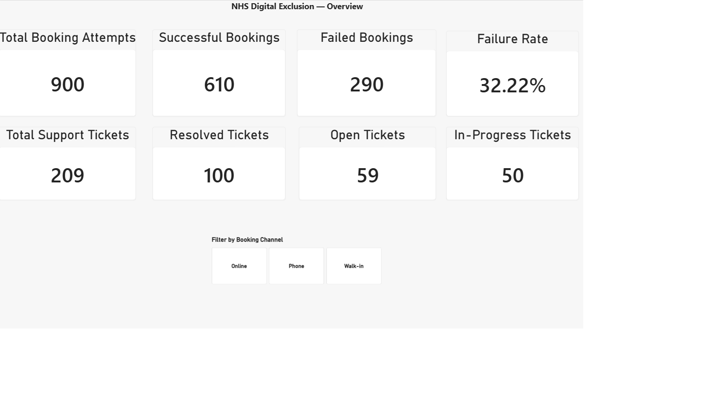
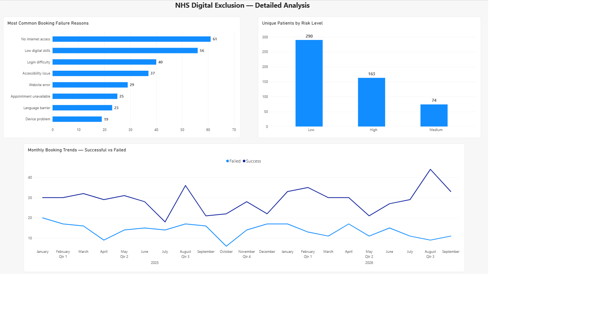
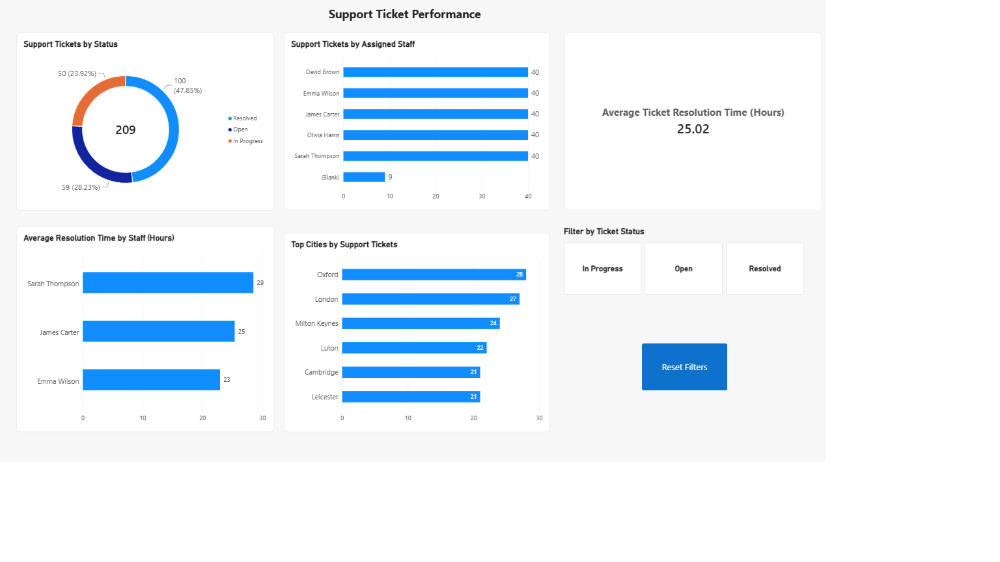

# NHS Digital Exclusion Analytics

## Project Overview

This project explores digital exclusion in GP appointment booking systems using MySQL, SQL and Power BI.

Digital exclusion can affect patients who have limited internet access, low digital literacy, accessibility difficulties or other barriers to using online healthcare services.

The aim of this project is to analyse booking outcomes, identify common reasons for unsuccessful bookings and examine how assisted booking support is provided.

**All data used in this project is synthetic and does not represent real NHS patients or actual NHS performance.**

## Tools and Technologies

* **MySQL:** Relational database for storing and querying data.
* **MySQL Workbench:** Writing and executing SQL queries.
* **SQL:** Data exploration, aggregation, joins and analysis.
* **Power BI:** Interactive dashboards and data visualisation.
* **DAX:** Calculating measures such as booking failure rate and average ticket resolution time.
* **Power Query:** Preparing data for analysis.

## Dataset

The synthetic dataset contains:

| Data                     | Records |
| ------------------------ | ------: |
| Patients                 |     300 |
| Booking attempts         |     900 |
| Successful bookings      |     610 |
| Failed bookings          |     290 |
| Assisted booking tickets |     209 |

The database contains four main tables:

1. `patients`
2. `booking_attempts`
3. `failure_reasons`
4. `assisted_booking_tickets`

These tables are connected through relationships that allow booking activity, patient information, failure reasons and support tickets to be analysed together.

## SQL Analysis

I developed 12 analytical SQL queries to investigate booking performance and support ticket activity.

The analysis covers:

* Total booking attempts and booking outcomes.
* Patient risk levels.
* Common booking failure reasons.
* Booking failure rates.
* Support ticket statuses.
* Ticket assignments to staff.
* Average ticket resolution time.
* Monthly booking trends.
* Patients experiencing repeated booking failures.
* High-risk booking attempts associated with support tickets.

The queries demonstrate SQL techniques including:

`SELECT`, `WHERE`, `GROUP BY`, `ORDER BY`, `HAVING`, `COUNT`, `COUNT DISTINCT`, `AVG`, `ROUND`, `CASE`, `INNER JOIN`, `TIMESTAMPDIFF` and `DATE_FORMAT`.

**View the SQL analysis:** [analysis.sql](sql/analysis.sql)

## Power BI Dashboards

I created a three-page Power BI report to present the results of the analysis.

### 1. Overview Dashboard

The overview page provides key performance indicators for booking activity and assisted booking support.

It includes:

* Total booking attempts.
* Successful and failed bookings.
* Booking failure rate.
* Total support tickets.
* Resolved, open and in-progress tickets.
* Interactive booking channel filter.



### 2. Detailed Analysis

This page investigates the factors associated with unsuccessful GP appointment bookings.

It includes:

* Most common booking failure reasons.
* Unique patients by risk level.
* Monthly trends comparing successful and failed bookings.

Patient risk levels are recorded against booking attempts. Therefore, an individual patient may appear in more than one risk category.



### 3. Support Ticket Performance

This page examines assisted booking support activity.

It includes:

* Support tickets by status.
* Tickets assigned to individual staff members.
* Average resolution time.
* Average resolution time by staff member.
* Cities with the highest numbers of support tickets.
* Interactive ticket status filter and reset button.



**Power BI report:** [Download the Power BI file](powerbi/NHS_Digital_Exclusion_Analytics.pbix)

The report uses Import mode, allowing the saved dashboards to be explored without connecting to the original MySQL database. Refreshing the dataset requires access to an appropriate data source.

## Key Findings

The analysis of the synthetic dataset identified the following:

| Metric                                       |      Result |
| -------------------------------------------- | ----------: |
| Total booking attempts                       |         900 |
| Successful bookings                          |         610 |
| Failed bookings                              |         290 |
| Booking failure rate                         |      32.22% |
| Support tickets created                      |         209 |
| Resolved support tickets                     |         100 |
| Open support tickets                         |          59 |
| In-progress support tickets                  |          50 |
| Average resolution time for resolved tickets | 25.02 hours |

### Main Observations

**1. Booking failures**

Of the 900 recorded booking attempts, 290 were unsuccessful, representing a failure rate of 32.22%.

**2. Digital exclusion barriers**

The most frequently recorded booking failure reasons were:

* No internet access: 61 cases.
* Low digital skills: 56 cases.
* Login difficulties: 40 cases.
* Accessibility issues: 37 cases.

These results highlight the types of barriers that could affect access to online appointment booking services.

**3. Assisted booking support**

A total of 209 support tickets were recorded.

Of these, 100 were resolved, 59 remained open and 50 were in progress.

**4. Ticket resolution performance**

The average resolution time for resolved support tickets was 25.02 hours.

The dashboard also allows resolution times to be compared across assigned staff members.

## Skills Demonstrated

Through this project, I practised:

* Exploring relational databases.
* Writing SQL queries to answer analytical questions.
* Joining tables and aggregating data.
* Investigating missing values and data quality.
* Creating DAX measures.
* Building interactive Power BI dashboards.
* Modelling relationships between tables.
* Validating Power BI calculations against SQL results.
* Communicating analytical findings through visualisations.

## Project Structure

```text
NHS-Digital-Exclusion-Analytics/
│
├── README.md
│
├── sql/
│   └── analysis.sql
│
├── powerbi/
│   └── NHS_Digital_Exclusion_Analytics.pbix
│
└── screenshots/
    ├── overview_dashboard.png
    ├── detailed_analysis.png
    └── support_ticket_analysis.png
```

## Project Background

This analytics portfolio project builds upon my NHS Digital Exclusion Support System university project.

The original application focuses on recording GP booking attempts, identifying patients who may need assistance and managing support tickets.

This separate analytics project focuses on exploring the resulting data using SQL and Power BI.

**Original application repository:** [NHS Digital Exclusion Support System](https://github.com/lgoloveckis/NHSDigitalExclusionWebsite)

## Future Improvements

Potential future developments include:

* Expanding the synthetic dataset.
* Adding further data quality checks.
* Investigating booking failures across different patient groups.
* Developing additional SQL analysis.
* Exploring automated data refresh processes.

---

**Disclaimer:** This is an educational portfolio project using synthetic data. It is not affiliated with or endorsed by the NHS.
